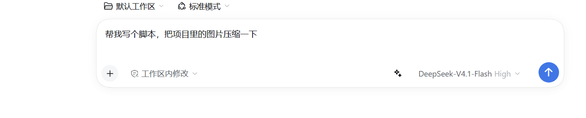
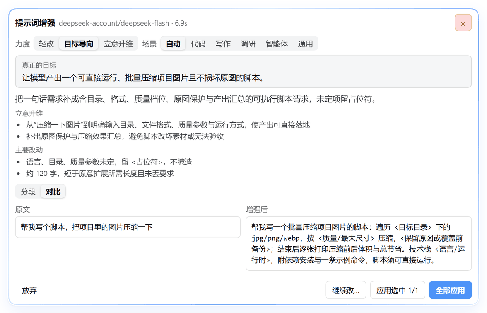
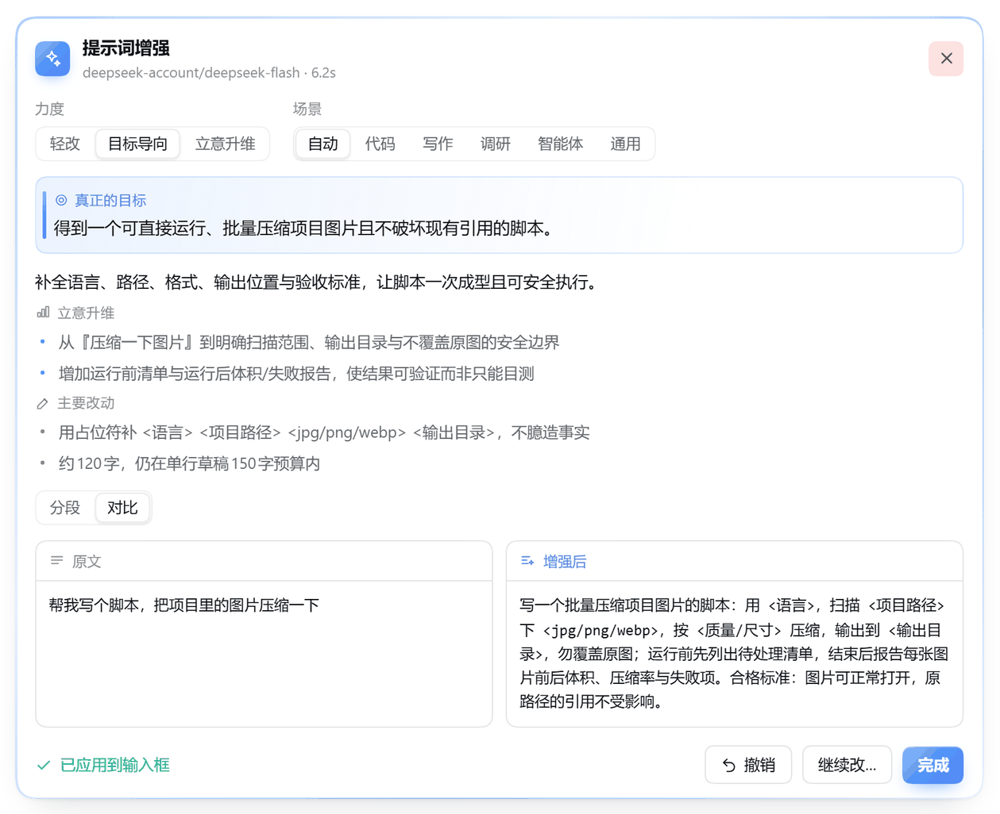
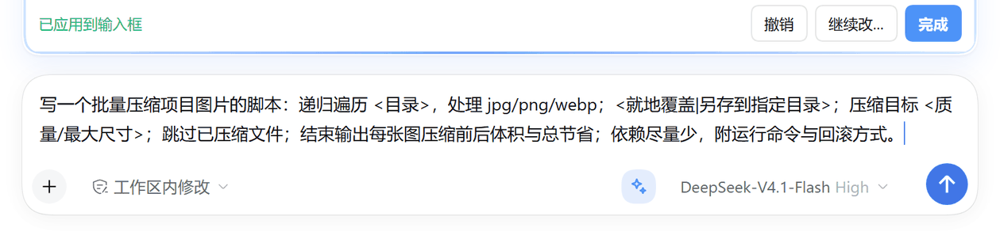
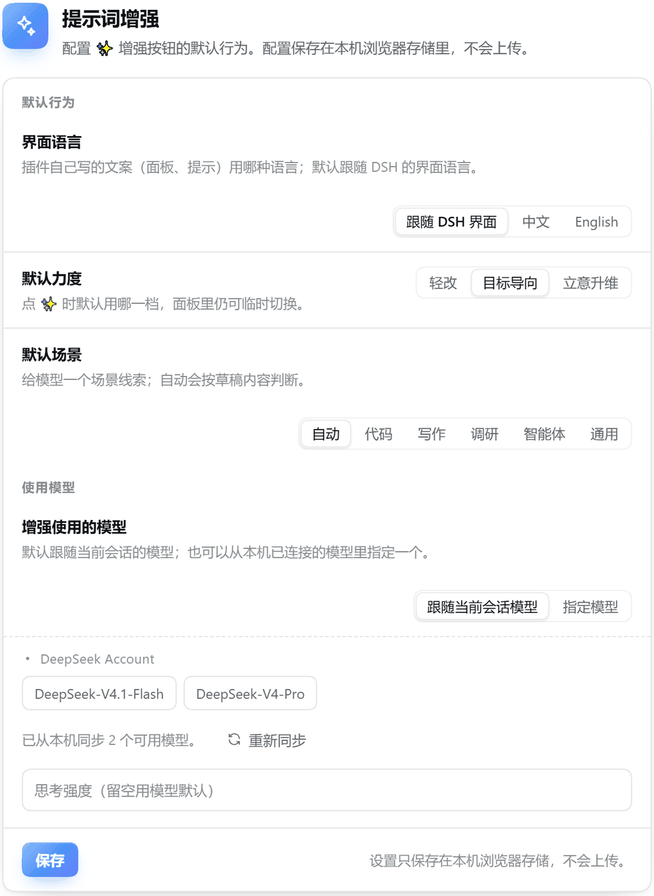
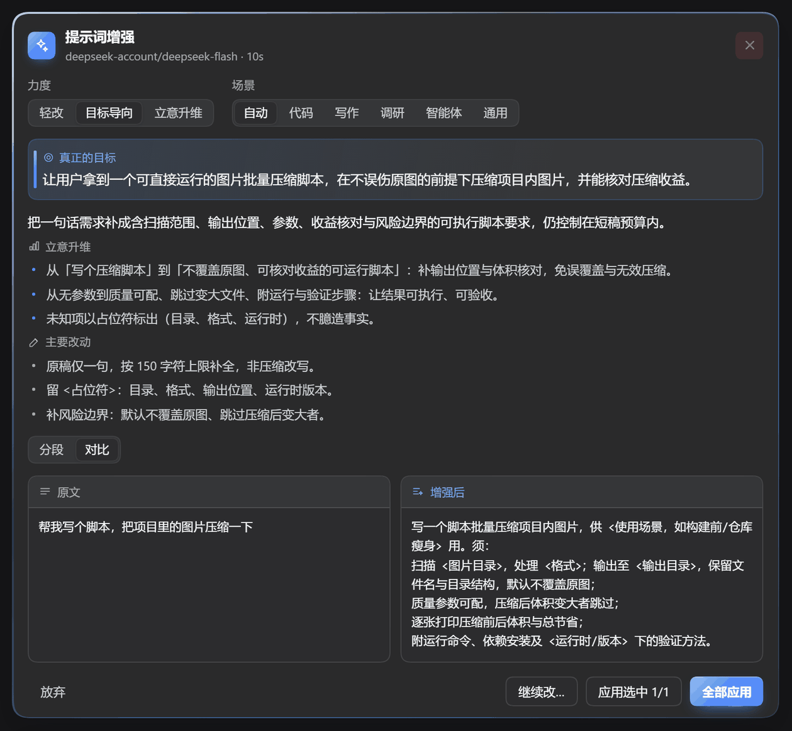
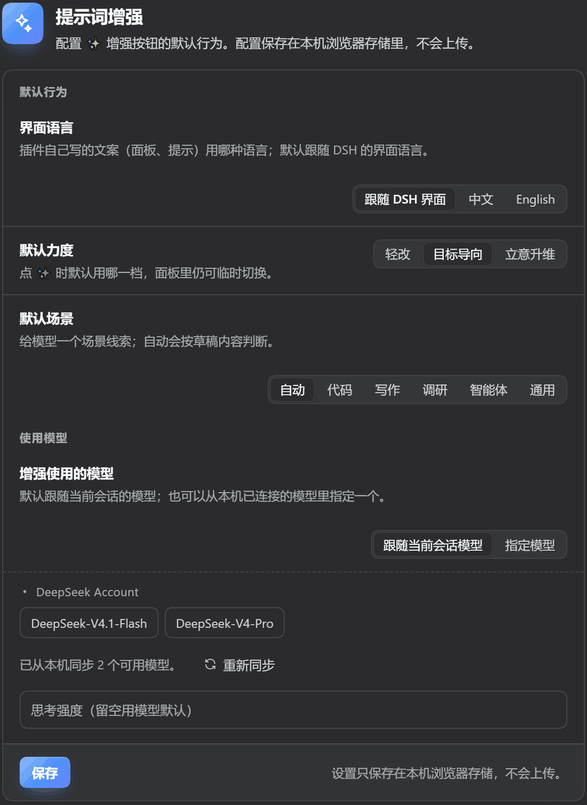
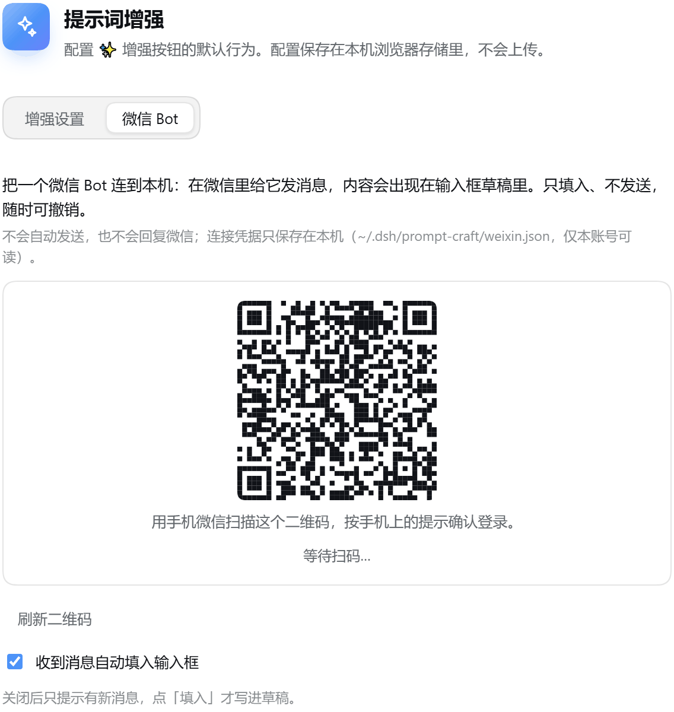

# dsh-prompt-craft

> Press ✨ in the DSH composer and turn a rough draft into a **goal-oriented** prompt: the plugin works out the outcome you actually want, then raises the aim — broader context, deeper assumptions and success criteria — **so review the diff first, then accept it hunk by hunk**.

`dsh-prompt-craft` is a prompt-enhancement plugin for [DeepSeek Harness](https://github.com/deepseek-ai/deepseek-harness). It adds a ✨ button to the composer tool row (just left of the model picker). One click sends the current draft to the model and shows the rewrite in an inline panel with a readable diff, per-hunk selection, and a refine loop.

[中文](./README.md)

## What it looks like

The ✨ button in the composer tool row (just left of the model picker), lit up when there is a draft:



Click it and the panel opens above the composer, sharing the composer's left and right edges — a glass card with a light blue gradient outline, the goal the rewrite serves and how the aim was raised at the top, and **Compare** as the default view:



Tick the changes you want; after applying, the merged prompt is written back into the composer and can be undone:



What lands in the composer is the tighter version — the same requirements in fewer characters:



The settings page speaks the same language: a hero band plus one large card, each row has the explanation on the left and the control on the right; "Model for enhancement" is picked straight from the models already connected on this machine, so you never have to remember a provider / model pair:



The dark theme uses the other token set — the glass panel, gradient outline, goal card and grouped cards all hold up:





The settings page also has a **WeChat Bot** tab: scan the QR code once to connect a WeChat bot to this machine. Messages you send to that bot then appear in the DSH composer draft (fill only, never sent):



Screenshots are from a real v0.4.0 run (DeepSeek-V4.1-Flash, `deepseek-flash`), no retouching.

## Why "goal first"

Clarifying the wording is not enough: you still may not get the result you wanted. This plugin works on the **goal** before the **phrasing**:

- **Name the real goal** — when the draft is just "write me a script", the model first decides what outcome you are after (one that runs once, or one you can maintain?), states it in one sentence in `goal`, and makes the prompt serve it.
- **Raise the aim** — from "finish this task" to "solve this problem / create this value", but only as far as your intent and domain allow; nothing invented.
- **Broaden the view** — who the result is for, what context it enters, adjacent constraints, what must keep working, the real risks and the alternatives worth considering.
- **Deepen the thinking** — hidden assumptions laid out, what "done well" means, how the result will be judged, and the trade-off that matters most.
- **Stay faithful** — no fabricated facts, no requirements you did not imply; when a key detail is missing it asks instead of guessing.

The result panel shows *the goal* and *how the aim was raised* (from X to Y), so you can see why the rewrite looks the way it does.

### A real run (v0.2.2, deepseek-flash)

Draft, one line:

> help me write a script to compress the images in this project

The panel then shows:

- **Goal it serves** — get a script that runs directly in the project, shrinks the images to an acceptable quality, and tells you how to run it and check the result.
- **How the aim was raised**:
  1. From "write a script" to "a runnable, verifiable, reusable compression script": language, directory, formats, output location and run command are pinned;
  2. Turning "compress them" into an acceptance criterion: per-image before/after sizes and the total ratio make the result checkable;
  3. Adding the risk boundary: back up before overwriting originals, skip already-compressed files, so project assets are not damaged.
- **Notes** state the compression, e.g. "25 characters → about 125, still under the 150-character cap for a one-line draft".

The rewritten prompt (full text, 125 characters):

> Write a runnable script that compresses the project's images as small as possible while keeping the quality acceptable. Needs: use `<language/version>`; scan `<directory>` for `<formats>`; `<lossy/lossless>` with target quality `<value>`; write results to `<output directory>`, back up before touching originals; skip already-compressed files; print per-image before/after sizes and the total ratio; end with the run command.

Compared with just "make it clearer", what appears here is the **goal, the acceptance criterion and the risk boundary** — while the character count is compressed to roughly the draft's own scale. Goal first, then structure, then the tightest wording that still carries everything.

## Why "diff first"

Most one-click optimizers replace your whole draft, so you cannot tell what changed or keep only half of it. This plugin does the opposite:

- **Diff before apply** — additions, removals and rewrites are grouped by line; every hunk (group) is individually selectable.
- **Apply only what you picked** — the merged text is written back into the composer, and "Undo" restores the original at any time.
- **Iterate instead of restarting** — type "make it shorter" to refine the last result.
- **Ask when the draft is underspecified** — if key constraints (language, format, length, audience…) are missing, the model returns 1–2 questions instead of guessing.

## Features

- ✨ **One-click enhancement** — a composer toolbar button; cancels while running.
- 🎯 **Visible goal and elevation** — the panel shows the goal the rewrite serves and what the aim was raised from and to.
- 🎚 **Three intensities** — Light (tidy wording, state the goal) / Goal-first (rewrite around the outcome you want) / Elevated (outcome, success criteria, boundaries and trade-offs in one brief).
- 🧭 **Automatic scenario detection** — code / writing / research / agent / general, or pick one manually.
- 🧩 **Diff preview + hunk-level accept** — per-hunk checkboxes, a compare view (default) or sections view, apply-all, and undo.
- ✂️ **Terse output** — compress the character count without dropping a requirement; Chinese may use a compact classical register (须 / 勿 / 免 / four-character phrases) but readability comes first, and a one-line draft gets a hard length cap.
- 🪟 **Same width as the composer** — the panel shares the composer's left and right edges, with a light blue gradient outline that stays clear in light and dark themes.
- 🎨 **Glass UI** — a translucent panel, a 1px gradient outline and inline SVG icons (no emoji), plus a settings page with a hero band, grouped cards and model tiles; everything rides on DSH's light/dark tokens and respects `prefers-reduced-motion`.
- ❓ **Clarifying questions** — answer 1–2 questions and the draft is rewritten with those answers folded in.
- 🔁 **Refine loop** — give the last rewrite another instruction.
- ⚙️ **One settings card** — every option sits in a single card, one row per setting with its explanation on the left and the control on the right; the title and copy follow the DSH UI language ("提示词增强" in Chinese).
- 🧠 **Models synced from this machine** — pick a model from the providers already connected here, grouped by provider; the default still follows the current session, so you never need to know a provider / model pair.
- 💬 **WeChat bot inbox** — connect from Settings → WeChat Bot by scanning a QR code (the plugin speaks Tencent iLink directly, no extra runtime); messages you send to the bot land in a local queue and are filled into the composer draft. Fill only: nothing is sent and nothing is replied to WeChat.
- 🔘 **Draft-state hint** — once the composer has text, ✨ gets a soft grey background so it is obvious the button is ready.
- 🌏 **Chinese and English UI** — follows the browser language, overridable in settings.

## How it compares

There are several prompt-related plugins in the DSH ecosystem. This only compares publicly visible capabilities (from each project's README and code, read in November 2026; their behaviour may change as they update):

| Capability | **dsh-prompt-craft** | dsh-prompt-crafter | dsh-voice-prompt-enhancer | dsh-prompt |
| --- | --- | --- | --- | --- |
| Focus | Goal-oriented rewrite | One-click rewrite | Rewrite + voice input | Template library (no rewriting) |
| Entry point | Composer toolbar ✨ + inline panel | "Optimize" button on the right | Composer toolbar ✨ | Left-side "Prompt" / `/prompt` |
| Names and shows the goal | ✅ "Goal it serves" | — | — | — |
| Elevation notes (from X to Y) | ✅ | — | — | — |
| Diff preview | ✅ line-level, compare by default (sections / compare) | — | — | — |
| Per-hunk accept | ✅ | — | — | — |
| Asks when under-specified | ✅ 1–2 questions | — | — | — |
| Refine loop | ✅ keeps the same goal | — | ✅ continue optimizing | — |
| Intensities / modes | 3 + automatic scenario | 3 + custom system prompt | 5 modes | — |
| Model strategy | Follows the session, can override | Free channel / follow / manual | Multi-model chain | — |
| Voice input | — | — | ✅ | — |
| Template library | — | — | inside modes | ✅ 24 presets + custom |
| Undo | Un-tick hunks / undo back to the original | Ctrl+Z | Whole-text revert | Undo after insert |
| License | MIT | MIT | Apache-2.0 | MIT |

If all you want is a template picker or voice input, those other plugins fit better. If what matters is **whether the rewrite points the right way, what exactly changed, and being able to keep only part of it**, this plugin is built for that.

## Install

Requires DSH `>= 0.2.2-rc.1`.

```bash
# Straight from GitHub (no npm publish needed)
dsh plugin --profile desktop add github:LONGSASASASASA/dsh-prompt-craft#v0.4.0

# Or from npm (once published)
dsh plugin --profile desktop add dsh-prompt-craft

# Local development: install the checkout itself (pnpm link semantics)
dsh plugin --profile desktop add file:/path/to/dsh-prompt-craft
```

Restart the DSH app afterwards — plugin bundles are loaded at startup. The ✨ button then appears in the composer tool row.

Uninstall:

```bash
dsh plugin --profile desktop remove dsh-prompt-craft
```

## Usage

1. Type a draft into the composer (a sentence, a requirement, a half-written prompt — anything).
2. Click ✨.
3. A panel opens above the composer:
   - **Compare** is the default view (original and rewrite side by side); switch to **Sections** for the per-hunk view;
   - tick the changes you want, then "Apply selected n/m" or "Apply all";
   - click "Refine…" and type an instruction to iterate.
4. After applying, edit or send as usual; "Undo" restores the pre-enhancement draft.

Incoming from WeChat: open Settings → "Prompt enhancement" → the **WeChat Bot** tab and scan the QR code once. After that, a message you send to the bot shows up in the composer draft (turn off "Fill incoming messages automatically" if you would rather get a notice first and click "Fill").

## Settings

The settings page lives in DSH's plugin settings ("Prompt enhancement" section). The whole page is one card, each row with its explanation on the left and the control on the right:

| Option | Description |
| --- | --- |
| UI language | Follow the DSH UI (default) / Chinese / English — decides the plugin's own copy |
| Default intensity | Light / Goal-first / Elevated (switchable in the panel) |
| Default scenario | Auto / Code / Writing / Research / Agent / General |
| Model for enhancement | Follow the current session by default; pick "Pin a model" to choose from the models synced from this machine (grouped by provider), or fill in provider / model / reasoning effort manually |

Where the models come from: the plugin syncs providers and models from the current session's model directory (open any conversation once and the list appears); the page shows "Synced N available models from this machine". When nothing can be synced it keeps manual entry as a fallback plus a "Sync again" button. By default the plugin uses exactly the model the current session is using (including temporary switches in the composer); it only overrides when you pin one. Settings are stored in the browser's `localStorage` and never uploaded.

Under the model row there is a **Test model** button: it sends one tiny call with the current selection (or the session model), shows "Connected · provider/model · Ns" on success, and prints the upstream message verbatim on failure — the quickest way to debug an unreachable route.

## WeChat Bot

The settings page has two tabs: **Enhancement** and **WeChat Bot**. In the WeChat Bot tab, click "Connect WeChat bot" and confirm the login with your phone:

- a text message you send to that bot enters a local queue and shows up in the DSH composer draft (automatic fill is on by default; turn it off to get a notice first and click "Fill");
- it only fills the draft — nothing is sent from DSH and nothing is replied to WeChat;
- the connection token is stored only on this machine at `~/.dsh/prompt-craft/weixin.json` with mode 0600;
- "Undo" restores the draft from before the fill; with automatic fill off, a notice above the composer offers "Fill" and "Ignore".

Under the hood the plugin speaks Tencent's iLink protocol directly (QR login plus a long-polling `getupdates` loop), so there is no OpenClaw or other background service involved. Known limits: the iLink session expires after roughly **24 hours** and needs a re-scan; text messages only; this is a personal-account bot channel, so use it within Tencent's terms.

## Troubleshooting: `the model call did not complete`

That message is the plugin's wrapper for a failed model call. Since v0.4.3 the panel also shows the upstream's **raw message**, and the settings page's **Test model** button reproduces the route on its own. Ranked by likelihood:

| Likelihood | Symptom | How to verify | Fix |
| --- | --- | --- | --- |
| 1. Reasoning parameter rejected by the route | upstream 400: `Unsupported value: 'none'` (gateways such as noki only accept low/medium/high/xhigh/max) | look for `reasoning.effort` / `Supported values` in the upstream message; or press **Test model** | v0.4.3 retries once with a supported level (prefers `low`); if it still fails, pin "Reasoning effort" to `low` |
| 2. Unknown model or route not enabled | upstream 404, `model_not_found` | **Test model**; or switch model in the composer | use a model that exists in the local list; check `llm-pi-ai.providers` in the profile |
| 3. Missing or expired credentials | `MISSING_CREDENTIAL`, 401/403 | read the upstream message; check the DSH account settings | sign in again or add the API key, then restart DSH |
| 4. Network / proxy / endpoint unreachable | `TIMEOUT` or `NETWORK` after a long wait | `curl` the provider `baseURL` directly | check proxy, `baseURL`, certificates; try another endpoint |
| 5. Rate limit / no quota | 429, `RATE_LIMIT`, `QUOTA` | code/message in the upstream text | retry later or switch models |
| 6. Body too large | `PAYLOAD_TOO_LARGE` (413) | is the draft over 20,000 characters? | trim the draft (1 MiB body, 20k characters per draft) |

> Host-side detail worth knowing: pi-ai's `openai-responses` builder injects `reasoning.effort: "none"` when a model declares reasoning but the request carries no effort. Official gateways usually accept `none`; custom routes such as noki only accept low..max and answer 400 — this is the common reason "local GLM works but noki-GPT says the model call did not complete". v0.4.3 retries around it.

## Compatibility and design notes

- The host half (`lib/host/index.cjs`) registers one `POST /dsh-prompt-craft/rpc` route and calls the model through `ctx.llm.stream()`. It rejects cross-site requests, caps bodies at 1 MiB, times out after 120 s, and parses (with one repair retry) the model's JSON output.
- The browser half (`lib/client.js`) registers four DSH slots: `conversation.input.right` (button), `conversation.input.dock` (panel and the WeChat inbox notice) and `settings.section` (settings page). No DOM patching, no host-code patching.
- The WeChat host half (`lib/host/weixin.cjs`) implements the iLink QR-login state machine and the `getupdates` long poll; messages land in a local queue, and each mounted composer polls `weixin/pending` and fills the draft. The QR code is rendered in the browser by `qrcode-generator` bundled into the client, so no runtime dependency is added.
- It only uses modules DSH already shares (`react`, …); no runtime dependency is installed into your profile.

## Development

```bash
npm install
npm run build      # rebuild lib/ (host files copied, client bundled by esbuild)
npm test           # node --test, 123 cases
npm run check      # verify lib/ matches src/ (no build drift)
```

Layout:

```
src/protocol.cjs        # shared constants, validation, error codes
src/host/index.cjs      # plugin entry (registers the route)
src/host/rpc.cjs        # HTTP route, stream collection, timeout, repair retry
src/host/templates.cjs  # prompt templates (intensity / scenario / output contract)
src/host/parse-output.cjs
src/host/resolve-model.cjs
src/client/index.js     # slot registration
src/client/{button,panel,actions,store,rpc,i18n,styles,settings,diff}.js
```

## Privacy

- No telemetry. Apart from the DSH host's local route, the plugin talks to Tencent iLink only after you connect the WeChat bot (QR login and the long poll that receives messages).
- The draft is forwarded to the model service you configured in DSH, and only when you click ✨.
- Settings live in `localStorage`; nothing else is written to disk.

## License

[MIT](./LICENSE)
