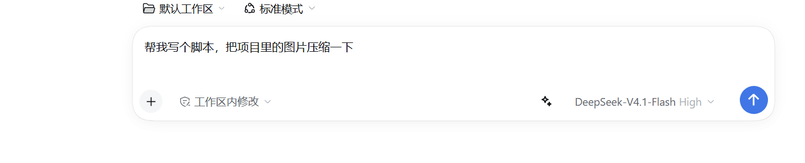
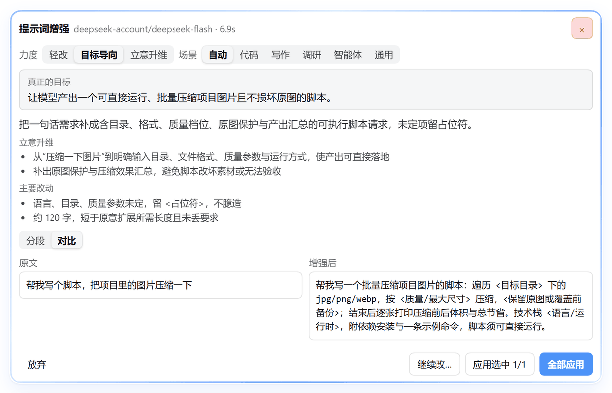
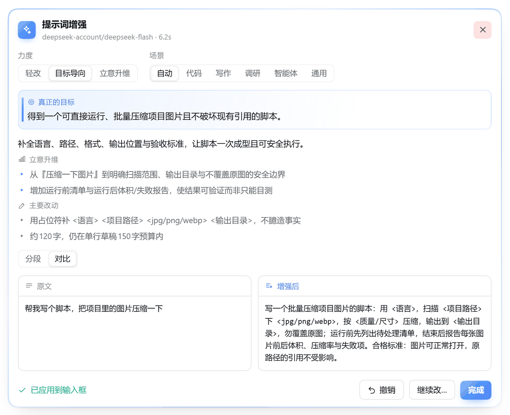
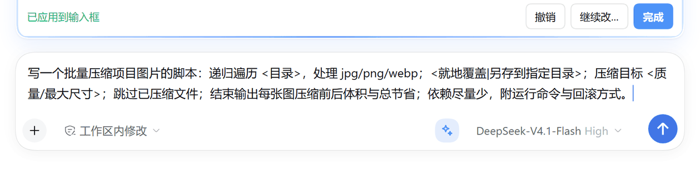
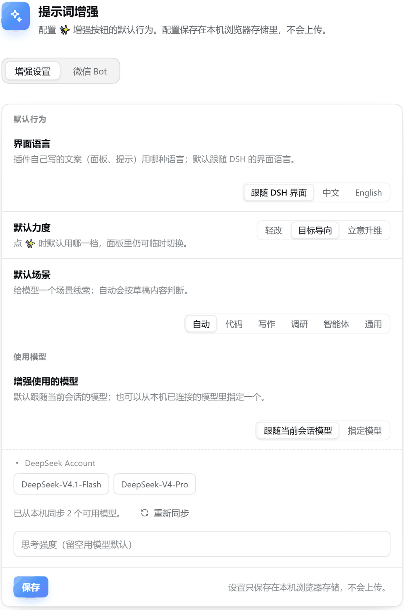
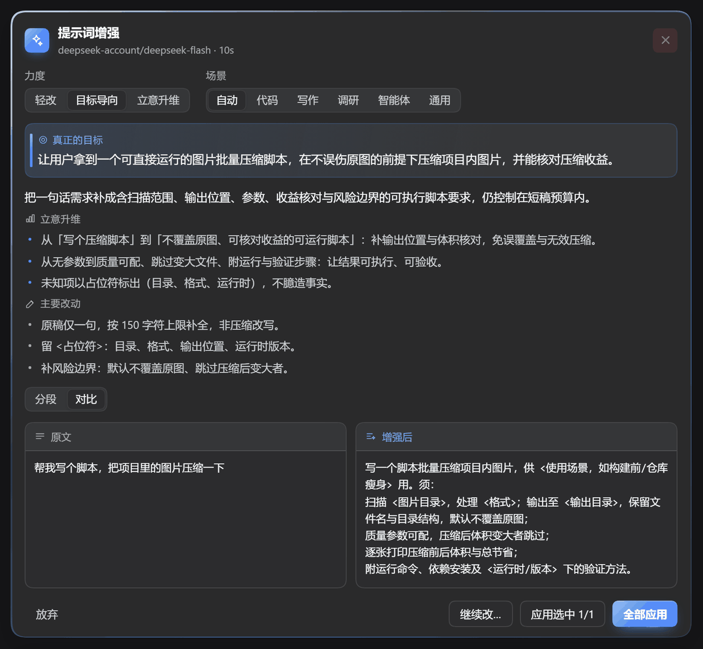
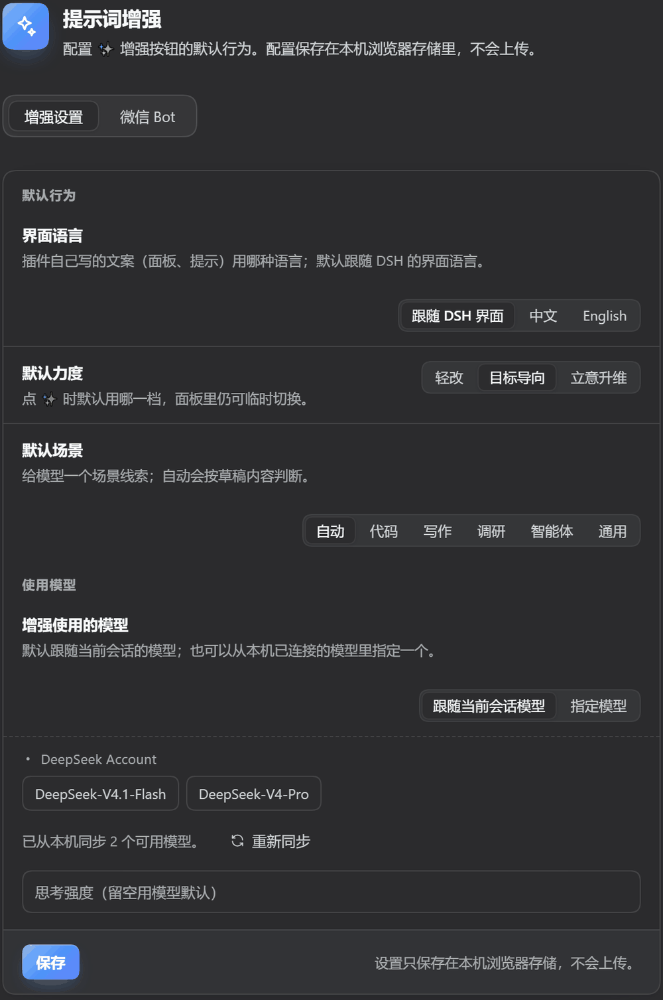
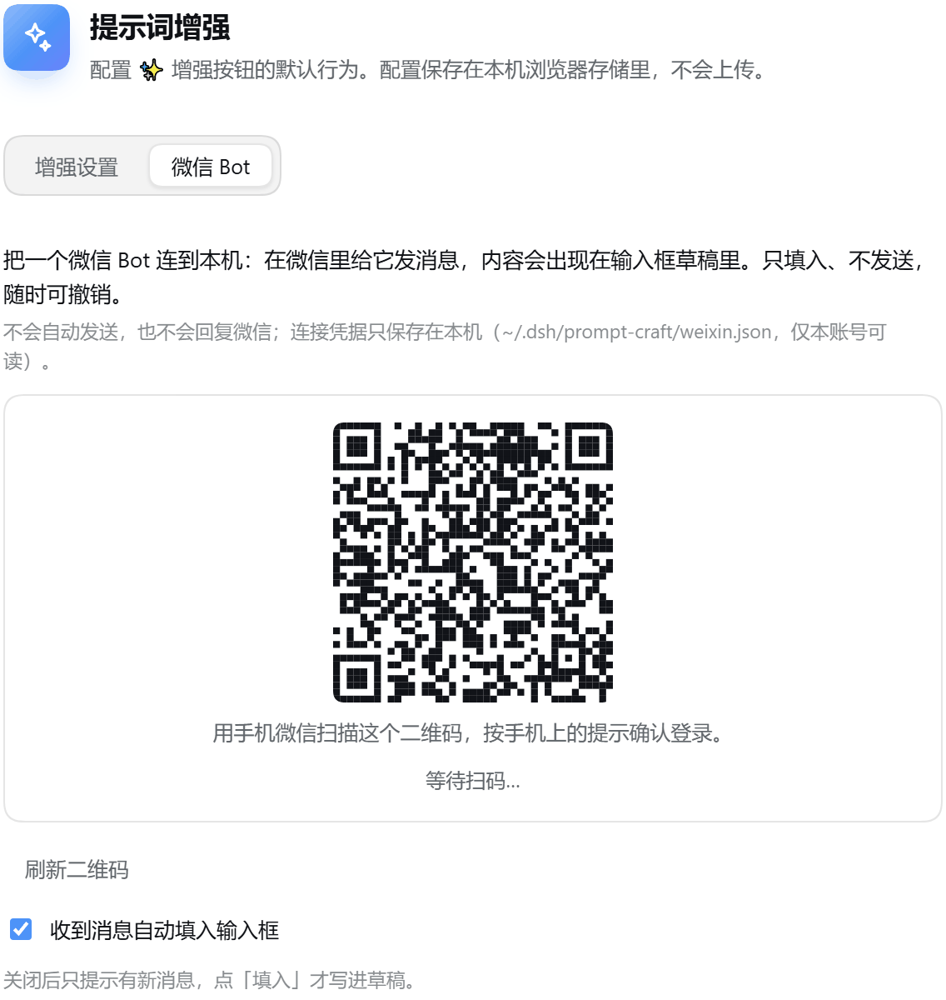

# dsh-prompt-craft

> 在 DSH 输入框里给草稿按一下 ✨，把它改写成**以目标为导向**的提示词：先认出你真正想达成的结果，再抬升立意（更广的视野、更深的假设与成功标准）——**先看 diff，再逐段接受**。

`dsh-prompt-craft` 是 [DeepSeek Harness](https://github.com/deepseek-ai/deepseek-harness) 的提示词增强插件：在输入框工具行加一个 ✨ 按钮（模型选择器左侧），点一下就把当前草稿交给模型改写，结果以内嵌面板的形式展示，带人类可读的差异对比、逐段勾选、继续追问。

[English](./README.en.md)

## 界面

输入框工具行里的 ✨（模型选择器左侧），有草稿时会点亮：



点一下，面板出现在输入框上方、与输入框左右对齐：玻璃质感的卡片 + 浅蓝渐变描边，顶部是「真正的目标」和「立意升维」说明，下面默认停在「对比」视图：



勾选想要的改动、应用后写回输入框，随时可以撤销：



写回输入框的就是更精炼的版本——同样的要求，字数更少：



设置页是同一套语言：hero 区 + 一节大卡片，每行左边是说明、右边是选项；「增强使用的模型」直接从本机已连接的模型里点选，不用自己背 provider / model：



深色主题下是另一套令牌，玻璃面板、渐变环、目标卡与卡片分组同样成立：





设置页的「微信 Bot」页签：扫码把微信 Bot 连到本机，连上之后，微信里发给它的消息会出现在 DSH 输入框的草稿里（只填入、不发送）：



截图来自 v0.4.0 的真实运行（DeepSeek-V4.1-Flash，`deepseek-flash`），未做后期美化。

## 为什么是「以目标为导向」

只把话说清楚，往往还是拿不到真正想要的结果。本插件先处理**目标**，再处理**措辞**：

- **先认出真正的目标**：草稿只是一句「帮我写个脚本」时，模型先判断你要的结果是什么（跑通一次、还是要能维护？），把它写成一句话放进 `goal`，再让提示词服务于它；
- **立意更高**：从「完成这个任务」抬到「解决这个问题 / 创造这个价值」，但只抬到你的意图与领域允许的范围，不臆造需求；
- **视野更广**：受众是谁、进入什么上下文、上下游有什么约束、哪些东西不能坏、真正的风险与备选方案；
- **思考更深**：隐含假设摊开、定义「做好」的标准、说明结果会被怎么检验、点明最关键的取舍；
- **忠于本意**：不编造事实、不加你没暗示的要求；缺关键信息时先问你，而不是替你猜。

增强结果面板会把「真正的目标」和「立意升维」（从 X 抬到 Y）直接显示出来，你能看到它为什么这么改。

### 真实效果（v0.2.2，deepseek-flash 实测）

草稿只有一句：

> 帮我写个脚本，把项目里的图片压缩一下

增强后面板顶部给出：

- **真正的目标**：拿到一个可直接运行的脚本，把项目里的图片体积压小、画质可接受，并知道如何运行和核对效果。
- **立意升维**：
  1. 从「写个脚本」到「可运行、可核对、可复用的压缩脚本」：补上语言、目录、格式、输出位置与运行命令；
  2. 把「压缩一下」变成验收标准：逐张打印前后体积与总压缩率，效果可验证；
  3. 补上风险边界：覆盖原图须先备份、跳过已压缩文件，避免误损项目素材。
- **主要改动**里会写明压缩幅度（例如「原句 25 字 → 约 125 字，仍在单行草稿 150 字上限内」）。

改写后的提示词（全文，125 字）：

> 写一个可运行的脚本，把项目里的图片压到尽量小且画质可接受。需：用 `<语言/版本>`；扫描 `<目录>` 下 `<格式>`；`<有损/无损>`，目标质量 `<数值>`；结果写到 `<输出目录>`，改原图须先备份；跳过已压缩文件；逐张打印前后体积与总压缩率；末尾附运行命令。

和只让它「把话说清楚」相比，这里多出来的是**目标、验收标准和风险边界**；但字数被压到接近草稿的量级——先定目标，再定结构，最后把措辞压到最紧。

## 为什么是「diff 优先」

大多数一键优化工具会把整段文本直接替换掉，你没法知道它改了什么、也没法只保留其中一半。本插件反过来：

- **先给你看 diff**：新增 / 删除 / 修改按行分组，每一组（hunk）都能单独勾选；
- **只应用你选择的**：合并结果写回输入框，随时「撤销」回到原文；
- **不满意就继续改**：不用重新开始，输入一句「再短一点」即可迭代；
- **信息不够先问你**：当草稿缺少关键约束（语言、格式、长度、受众……）时，模型会先返回 1–2 个问题，而不是替你瞎猜。

## 功能

- ✨ **一键增强**：输入框工具行按钮，快捷键可达，运行中可取消。
- 🎯 **目标与立意可见**：面板显示「真正的目标」和「立意升维」说明，改写逻辑透明。
- 🎚 **三档力度**：轻改（理顺表达、把目标说清楚）/ 目标导向（围绕真正想要的结果重写）/ 立意升维（目标、成功标准、边界与取舍一次写全）。
- 🧭 **自动场景识别**：自动判断代码 / 写作 / 调研 / Agent / 通用，也可手动指定。
- 🧩 **diff 预览 + 分段接受**：逐 hunk 勾选、对比视图（默认）/ 分段视图、全部应用、撤销。
- ✂️ **精炼输出**：不丢要求的前提下压缩字数，中文可带文言式紧凑（须 / 勿 / 免 / 四字短语），但以可读为先；单行草稿有字数上限。
- 🪟 **与输入框等宽**：面板左右边缘与输入框对齐，外圈浅蓝渐变描边，深浅色主题下都清晰。
- 🎨 **玻璃质感界面**：半透明面板 + 1px 渐变描边 + 内联 SVG 图标（不用 emoji），设置页有 hero 区、分组卡片与模型磁贴；全部跟随 DSH 的明暗主题令牌，并尊重 `prefers-reduced-motion`。
- ❓ **追问补全**：缺信息时先问 1–2 个问题，回答后带着答案重写。
- 🔁 **迭代改稿**：在上一版基础上继续给修改意见。
- ⚙️ **设置页**：单张卡片，每行一组文案 + 选项；标题与文案跟随 DSH 界面语言（中文下就是「提示词增强」）。
- 🧠 **模型从本机同步**：设置里直接点选本机已连接的模型（按 provider 分组），默认仍跟随当前会话，不要求你记 provider / model。
- 💬 **微信 Bot 收件箱**：设置页「微信 Bot」页签扫码连接（借用腾讯 iLink 协议，零额外运行时），微信里发给 Bot 的消息会进本地队列并自动填入输入框草稿；只填入、不发送、不回复。
- 🔘 **草稿态提示**：输入框有内容时 ✨ 带一层浅灰底，一眼看出「可以点了」。
- 🌏 **中英双语**：跟随浏览器语言，可在设置里覆盖。

## 和同类插件比

DSH 插件市场里已经有不少提示词相关插件。这里只比较公开可见的能力（信息来自各仓库的 README 与代码，2026-11 抓取，可能随对方版本更新而变化）：

| 能力 | **dsh-prompt-craft** | dsh-prompt-crafter | dsh-voice-prompt-enhancer | dsh-prompt |
| --- | --- | --- | --- | --- |
| 定位 | 目标导向改写 | 一键改写 | 改写 + 语音输入 | 模板库（不改写） |
| 入口 | 输入框工具行 ✨ + 内嵌面板 | 输入框右侧「优化」 | 输入框工具行 ✨ | 输入框左侧「Prompt」/ `/prompt` |
| 认出并显示目标 | ✅「真正的目标」 | — | — | — |
| 立意升维说明（从 X 抬到 Y） | ✅ | — | — | — |
| diff 预览 | ✅ 行级，默认对比视图（分段 / 对比） | — | — | — |
| 逐段接受 | ✅ 按 hunk 勾选 | — | — | — |
| 信息不足先追问 | ✅ 1–2 个问题 | — | — | — |
| 迭代改稿 | ✅ 保持目标继续改 | — | ✅ 可继续优化 | — |
| 力度 / 模式 | 3 档 + 自动场景识别 | 3 档 + 自定义系统提示 | 5 种模式 | — |
| 模型策略 | 跟随当前会话，可显式覆盖 | 免费通道 / 跟随 / 手动 | 多模型按序尝试 | — |
| 语音输入增强 | — | — | ✅ | — |
| 模板库 | — | — | 模式内模板 | ✅ 24 条 + 自定义 |
| 撤回方式 | 逐段取消 / 一键撤销回原文 | Ctrl+Z | 整段撤回 | 插入后撤销 |
| 许可证 | MIT | MIT | Apache-2.0 | MIT |

如果你主要想要「模板速查」或「语音输入」，那几个插件更合适；如果你在意**改写方向对不对、到底改了什么、能不能只留下一部分**，这个插件就是为这件事做的。

## 安装

需要 DSH `>= 0.2.2-rc.1`。

```bash
# 直接从 GitHub 安装（推荐，无需 npm 发布）
dsh plugin --profile desktop add github:LONGSASASASASA/dsh-prompt-craft#v0.4.0

# 或从 npm（发布后）
dsh plugin --profile desktop add dsh-prompt-craft

# 本地开发：直接装本地目录（pnpm link 语义）
dsh plugin --profile desktop add file:C:\path\to\dsh-prompt-craft
```

安装后**重启 DSH 应用**（插件 bundle 在启动时加载）。重启后输入框工具行会出现 ✨ 按钮。

卸载：

```bash
dsh plugin --profile desktop remove dsh-prompt-craft
```

## 使用

1. 在输入框里写下草稿（一句话、一段需求、半成品提示词都行）。
2. 点 ✨。
3. 面板出现在输入框上方：
   - 顶部是「真正的目标」与「立意升维」说明；
   - 默认停在**对比**视图（原文 / 增强后并排），也可切到**分段**逐 hunk 看；
   - 勾选你想要的改动，点「应用选中 n/m」或「全部应用」；
   - 想改得更狠或更轻，点「继续改…」输入一句意见。
4. 应用后可直接编辑或发送；「撤销」回到增强前的原文。

想从微信进来：设置 → 「提示词增强」→「微信 Bot」页签，扫码连接一次。之后在微信里给这个 Bot 发消息，内容会自动出现在输入框草稿里（可在设置里关掉「收到消息自动填入」，改成先提示、再点「填入」）。

## 设置

设置页位于 DSH 设置的插件页（「提示词增强」一节）。整个设置是一张卡片，行内左边是说明、右边是控件：

| 项 | 说明 |
| --- | --- |
| 界面语言 | 跟随 DSH 界面（默认）/ 中文 / English；决定插件自己的文案语言 |
| 默认力度 | 轻改 / 目标导向 / 立意升维（面板里可临时切换） |
| 默认场景 | 自动识别 / 代码 / 写作 / 调研 / Agent / 通用 |
| 增强使用的模型 | 默认跟随当前会话；点「指定模型」后，可从本机已同步的模型里按 provider 分组点选，也可以手填 provider / model / 思考强度 |

模型从哪来：插件从你当前会话的模型目录里同步 provider 与模型（打开过一次对话即可），设置页会显示「已从本机同步 N 个可用模型」；同步不到时保留手动填写作为兜底，并提供「重新同步」。模型策略默认完全跟随当前会话（含会话里临时切换的模型），只有你显式指定时才覆盖。设置保存在本机浏览器 `localStorage`，不上传。

## 微信 Bot 连接

设置页有「增强设置 / 微信 Bot」两个页签。在「微信 Bot」里点「连接微信 Bot」，用手机微信扫码确认后即可：

- 微信里给这个 Bot 发**文本**消息 → 消息进入本机队列 → DSH 输入框草稿里出现内容（默认自动填入，可在同一页关掉）；
- **只填入，不发送，不回复微信**：内容进的是草稿，发不发、怎么改，都由你决定；
- 连接凭据只保存在本机 `~/.dsh/prompt-craft/weixin.json`（文件权限 0600），不上传、不写日志；
- 「撤销填入」把草稿恢复成填入前的样子；关掉自动填入时，输入框上方会出现提示条，点「填入」才写进草稿。

实现上是**只借用腾讯的 iLink 协议**：插件自己实现扫码登录与长轮询（`getupdates`），不依赖 OpenClaw 或任何常驻进程。已知限制：iLink 会话约 **24 小时**到期，需要在设置页重新扫码；仅支持文本消息；这是个人微信账号的 Bot 通道，请按腾讯的服务条款谨慎使用。

## 兼容性与实现

- 宿主半（`lib/host/index.cjs`）注册一个 `POST /dsh-prompt-craft/rpc` 路由，用 `ctx.llm.stream()` 调模型；带来源校验（拒绝跨站请求）、1 MiB 请求体上限、120s 超时、JSON 输出解析与一次修复重试。
- 浏览器半（`lib/client.js`）通过 DSH 的 `slots` 服务注册四个插槽：`conversation.input.right`（按钮）、`conversation.input.dock`（面板 + 微信收件箱提示条）、`settings.section`（设置页）。不修改 DOM、不 patch 宿主代码。
- 微信 Bot 的宿主半（`lib/host/weixin.cjs`）实现 iLink 扫码登录状态机与 `getupdates` 长轮询，消息落本地队列，客户端按会话轮询 `weixin/pending` 后写入草稿；QR 码在浏览器里用打包进 bundle 的 `qrcode-generator` 渲染，运行时零依赖。
- 只依赖 DSH 已提供的共享模块（`react` 等），不额外安装运行时依赖。

## 开发

```bash
npm install
npm run build      # 生成 lib/（host 半逐文件复制 + esbuild 打包客户端）
npm test           # node --test，105 个用例
npm run check      # 校验 lib/ 与源码一致（无构建漂移）
```

源码结构：

```
src/protocol.cjs        # host/client 共享的常量、校验、错误码
src/host/index.cjs      # 插件入口（注册路由）
src/host/rpc.cjs        # HTTP 路由、流式收集、超时、修复重试
src/host/templates.cjs  # 提示词模板（力度 / 场景 / 输出约定）
src/host/parse-output.cjs
src/host/resolve-model.cjs
src/client/index.js     # 插槽注册
src/client/{button,panel,actions,store,rpc,i18n,styles,settings,diff}.js
```

## 隐私

- 插件不发送任何遥测；除 DSH 宿主自身的本机路由外，只有在你连接微信 Bot 后才与腾讯 iLink 服务器通信（扫码登录与长轮询收消息）。
- 草稿只在你点击 ✨ 时经本机 DSH 宿主转发给你在 DSH 里配置的模型服务。
- 设置存在浏览器 `localStorage`，不写入磁盘其他位置。

## License

[MIT](./LICENSE)
